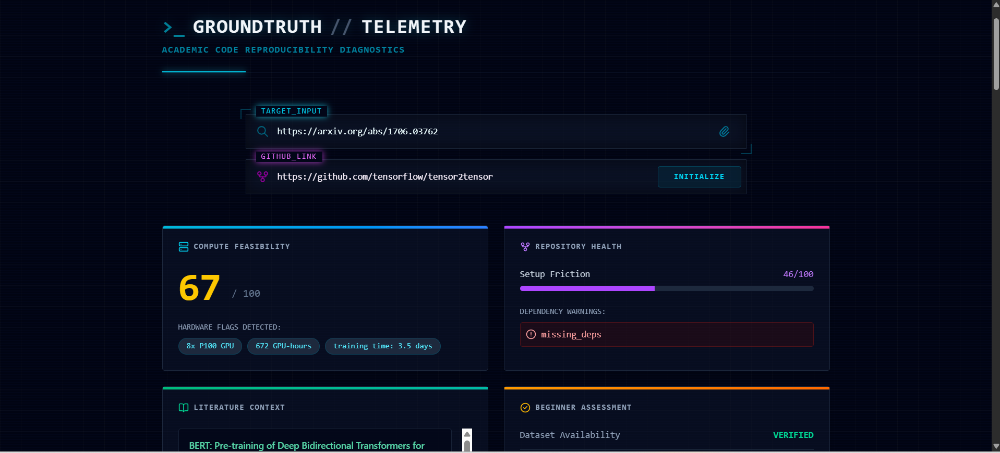
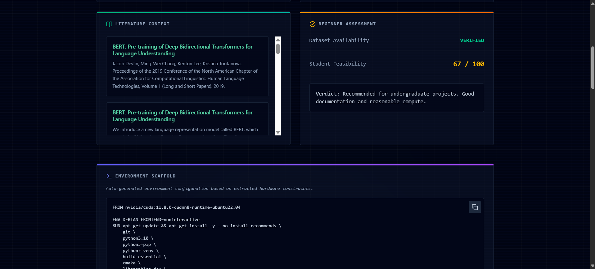
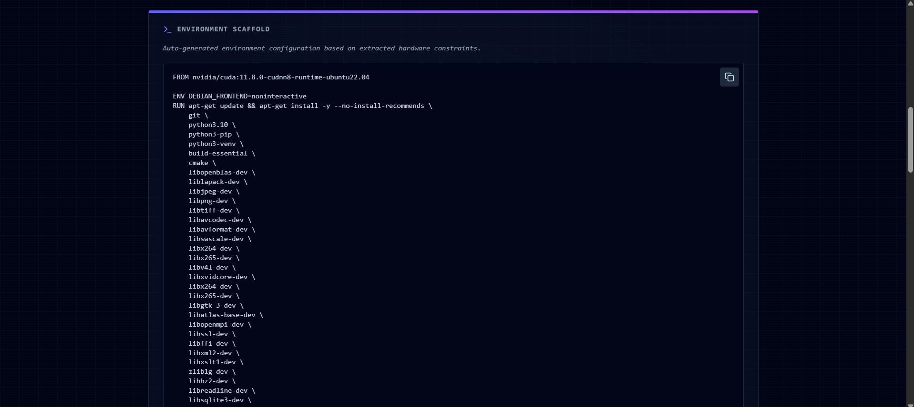

# Groundtruth

### Can a student actually reproduce this paper?

[](https://www.python.org/)
[](https://fastapi.tiangolo.com/)
[](https://nextjs.org/)
[](https://groq.com/)

**Live demo:** **[https://groundtruth-ten-rho.vercel.app](https://groundtruth-ten-rho.vercel.app)** · paste an arXiv link (try `https://arxiv.org/abs/1706.03762`) and click **Initialize**. *(Free hosting sleeps when idle, so the first request can take about a minute. The AI provider's free tier has a daily limit, so if you see a "busy" message, try again later.)*



A paper says "we trained on 512 GPUs for three weeks". A student with one laptop can't tell, before spending a weekend on setup, whether the work is within reach. The answer is buried in the paper's text, and the code repository may or may not run.

**Groundtruth reads an arXiv paper and its code repository and tells you how hard it is to reproduce.**
- It finds the compute the authors say they used: accelerator model, count, GPU-hours, training time, model size.
- It scores feasibility for a student from 0 to 100 (higher means easier).
- It checks the GitHub repository for the files a clean setup needs.
- It looks up related papers, checks that the dataset can be found, and generates a starter environment file.

It never guesses. If the paper does not state its hardware, Groundtruth reports none rather than inventing it.

## Screenshots
| | |
|---|---|
| **Compute feasibility and repository health:** "Attention Is All You Need" with its GitHub repository. 8x P100, 672 GPU-hours and 3.5 days are read from the paper, the score is 67/100, and the repo's setup friction is 46/100 with a dependency warning<br> | **Literature context and beginner assessment:** related papers from OpenAlex, a dataset availability check, and a plain-language verdict<br> |
| **Environment scaffold:** a Dockerfile generated from the extracted hardware, ready to copy. A CUDA base image appears only when a GPU is needed<br> | |

---

## What it checks
| Signal | What you get | Where it comes from |
|---|---|---|
| **Compute** | Accelerator model, count, memory, GPU/TPU-hours, training time, multi-node, largest model size | The paper's own text, extracted by an LLM, only where the authors state it |
| **Feasibility score** | 0 to 100 for a student, higher is easier | Rule-based code over the extracted facts. The LLM does not pick the score |
| **Repository health** | A setup-friction score and dependency warnings | The GitHub API |
| **Literature context** | Related papers | OpenAlex |
| **Dataset availability** | Whether the named dataset can be found | The Hugging Face Hub |
| **Environment scaffold** | A Dockerfile or setup script for the repo | An LLM, from the hardware flags and the repo's missing files |

## Contents
1. [How it works](#how-it-works)
2. [Why the numbers can be trusted](#why-the-numbers-can-be-trusted)
3. [Evaluation](#evaluation)
4. [API overview](#api-overview)
5. [Quick start](#quick-start-windows-powershell)
6. [Deploy](#deploy)
7. [Repository layout](#repository-layout)
8. [Limitations & roadmap](#limitations--roadmap)

---

## How it works
```
Browser (Next.js, Vercel)
   │  POST /api/analyze  { arxiv_url, github_url }
   ▼
FastAPI (Render)
   ├─ arXiv + PDF text (PyMuPDF / pdfplumber)
   ├─ pick the passages about hardware ──► Groq LLM (temperature 0) ──► facts as JSON
   ├─ check the facts against the paper text ──► rule-based feasibility score
   ├─ GitHub API ──► repository health
   ├─ OpenAlex ──► literature context
   └─ Hugging Face Hub ──► dataset check
```

| Stage | What happens |
|---|---|
| **1. Fetch** | Resolves the arXiv link, downloads the PDF and extracts its text. If only the abstract is available, the result is flagged `text_source` ≠ `full_text` instead of being passed off as a full read |
| **2. Select** | Keeps the title, abstract and introduction, plus every sentence (and its neighbours) that mentions hardware, so the model sees the relevant evidence and not 100 pages |
| **3. Extract** | The LLM returns structured facts only. Its instructions say: report only what the paper explicitly states, only for the authors' own experiments, and the largest experiment if there are several |
| **4. Verify** | A tolerant JSON parser, a filter for hardware counts that come from other people's work, and a backstop that recovers an accelerator name the model dropped (see below) |
| **5. Score** | Plain Python turns the facts into a 0 to 100 score |
| **6. Enrich** | Repository health, related papers, dataset check, and on request the environment scaffold |

## Why the numbers can be trusted
- **The LLM extracts, code decides.** The feasibility score is computed by rules from the extracted facts, so the same facts always give the same score.
- **Third-party hardware is ignored.** "Prior work used 16 GPUs" must not become this paper's compute. Counts are kept only when the sentence is the authors' own.
- **A deterministic backstop for dropped names.** Evaluation showed the model sometimes returned `1x GPU` and left out `A100`, which also changed the score by about 15 points. If the model reports a count but no model name, and exactly one accelerator name appears in a first-person, non-citing sentence of the paper, that name is recovered. If several names appear, nothing is guessed.
- **No hardware stays no hardware.** Papers that state none are a test category: any invented hardware fails the check.
- **Failure is visible.** Abstract-only analysis, a missing paper and an exhausted AI quota each produce a clear message in the interface instead of a blank page.

## Evaluation
A 50-case golden set lives in [`backend/eval`](backend/eval). Each run calls the API and grades the response.

| Category | Cases | What it tests |
|---|---|---|
| `big_compute` | 5 | Huge-compute papers (LLaMA, PaLM, GPT-3) must score low |
| `tpu_based` | 4 | TPU papers must report TPU |
| `gpu_known` | 14 | The expected GPU model must appear in the extracted compute |
| `no_hardware` | 9 | Papers that state no hardware must produce none |
| `needs_labeling` | 12 | Ingest, schema and repository checks; hardware is checked only where labelled |
| edge cases | 6 | Bad links and missing papers must fail cleanly, unusual valid inputs must succeed |

Checks per case: HTTP success, paper ingest, response schema, GPU match, no invented hardware, score range, repository flags (compared with GitHub's own file listing) and graceful errors.

**Results**
- **48 of 50 cases passed** in the full run.
- The two failures were a request timeout (a network drop mid-run, it passed on rerun) and `gpu_11`, where the model sometimes dropped `A100`. The prompt rule and the backstop above were added in response, and a 5-repeat rerun of `gpu_11` then passed 5 of 5. A fresh full-suite run is the next step.
- **Score ordering holds:** 10 of 10 pairwise rules pass (for example PaLM scores below YOLO), the mean score of heavy-compute papers is 14 against 75 for papers with no hardware, and the Spearman correlation between score and extracted accelerator-hours is **-0.94** over the 11 papers where hours were extracted.

> **Read these numbers carefully.** The golden set is small and was written by the author, so it is a regression suite, not an independent accuracy benchmark. The score is a rule-based estimate of the compute barrier. It has not been validated against real reproduction attempts.

```powershell
cd backend\eval
python run_eval.py --golden golden_set.jsonl                  # all 50 cases
python run_eval.py --golden golden_set.jsonl --only gpu_11 --repeat 5
python test_ranking.py results\run_<timestamp>.json           # ordering checks, no API calls
```

A full run costs roughly the AI provider's whole free daily token allowance, so run it sparingly.

## API overview
| Endpoint | Purpose |
|---|---|
| `POST /api/analyze` | Analyse an arXiv link, optionally with a GitHub repository |
| `POST /api/upload` | Analyse an uploaded PDF |
| `POST /api/scaffold` | Generate a Dockerfile or setup script from hardware flags and missing files |
| `GET /health` | Health check |
| `GET /docs` | Interactive API documentation |

```bash
curl -X POST https://groundtruth-api-pg7k.onrender.com/api/analyze \
  -H "Content-Type: application/json" \
  -d '{"arxiv_url":"https://arxiv.org/abs/1706.03762","arxiv_id":"1706.03762","github_url":""}'
```

```json
{
  "paper_title": "Attention Is All You Need",
  "hardware_flags": ["8x P100 GPU", "672 GPU-hours", "training time: 3.5 days"],
  "student_feasibility_score": 67,
  "dataset_validity": true,
  "github_metrics": null,
  "citations": [{ "title": "...", "context": "..." }],
  "text_source": "full_text"
}
```

## Quick start (Windows PowerShell)
Prerequisites: Python 3.11, Node 20+, a free Groq API key from <https://console.groq.com/keys>, and a GitHub personal access token with no extra permissions (public repositories only).

```powershell
git clone https://github.com/tanishkagoswami/Groundtruth.git
cd Groundtruth\backend
python -m venv venv
.\venv\Scripts\Activate.ps1
pip install -r requirements.txt
```

Create `backend\.env` (never commit it):
```
GROQ_API_KEY=your_groq_key
GITHUB_TOKEN=your_github_token
```

Start the API:
```powershell
uvicorn app.main:app --port 8000
```

In a second terminal:
```powershell
cd frontend
npm install
npm run dev          # http://localhost:3000
```

Open <http://localhost:3000>, paste an arXiv link and click **Initialize**.

### Configuration
| Variable | Where | Default | Meaning |
|---|---|---|---|
| `GROQ_API_KEY` | backend | none | Required. Key for the LLM extraction |
| `GITHUB_TOKEN` | backend | none | Required for repository analysis. Without it GitHub lookups fail |
| `ALLOWED_ORIGINS` | backend | `http://localhost:3000` | Comma-separated list of frontend origins allowed by CORS, no trailing slash |
| `OPENALEX_EMAIL` | backend | none | Optional. Puts OpenAlex requests in its faster "polite pool" |
| `GT_LLM_CACHE` | backend | off | Set to `1` to cache LLM answers on disk. Leave it off when testing for variation |
| `NEXT_PUBLIC_API_URL` | frontend | `http://localhost:8000` | Backend address. Set before the build, because Next.js bakes it in |

## Deploy
The backend runs on **Render** and the frontend on **Vercel**, both on free plans.

**Backend (Render, Web Service)**
1. Connect this repository. Set **Root Directory** to `backend`.
2. Build command: `pip install -r requirements.txt`
3. Start command: `uvicorn app.main:app --host 0.0.0.0 --port $PORT`
4. Environment variables: `PYTHON_VERSION` (for example `3.11.4`), `GROQ_API_KEY`, `GITHUB_TOKEN`, `ALLOWED_ORIGINS` ([your Vercel address](https://groundtruth-ten-rho.vercel.app/)).
5. Health check path: `/health`

**Frontend (Vercel)**
1. Import the repository. Set **Root Directory** to `frontend`.
2. Add `NEXT_PUBLIC_API_URL` ([your Render address, no trailing slash](https://groundtruth-api-pg7k.onrender.com)) **before** the first deploy. If you add it later, redeploy.

The free Render plan sleeps when idle and its disk is temporary, so the on-disk cache does not survive a restart.

## Repository layout
```
backend/
  app/
    api/         endpoints: analyze, upload, scaffold
    models/      request and response schemas
    services/    arxiv, pdf_parser, llm (extraction and scoring), github, semantic (OpenAlex), dataset, unpaywall
    main.py      FastAPI app and CORS
  eval/          golden set, grader checks, eval runner, ranking test, scaffold test
frontend/src/
  app/           the page
  components/    RepositoryHealth, LiteratureContext, BeginnerAssessment, WorkspaceScaffold
  lib/api.ts     API client with timeout and readable error messages
docs/screenshots/
```

## Limitations & roadmap
**Limitations today**
- The free Groq tier has a daily token limit, which is only a few dozen analyses. After that the interface shows a "busy" message until the limit recovers.
- Free hosting adds a cold start of about a minute after idle time, and large papers can take a minute or more to analyse.
- Extraction depends on the paper stating its hardware. If it does not, Groundtruth reports none, which is the intended behaviour, but the score is then less informative.
- The evaluation set is small and self-written, and the feasibility score has not been checked against real reproduction attempts.
- The dataset check looks the name up on the Hugging Face Hub, and a fuzzy match can give a false positive on generic names.
- Only arXiv papers and uploaded PDFs are supported.

**Roadmap**
- Pre-computed example papers so the demo works even when the AI quota is used up.
- A full evaluation rerun after every extraction change.
- Calibrating the score against papers where reproduction cost is known.
- Moving slow analyses to a background job with a progress indicator.

## Author
Built by Tanishka · [@tanishkagoswami](https://github.com/tanishkagoswami)

